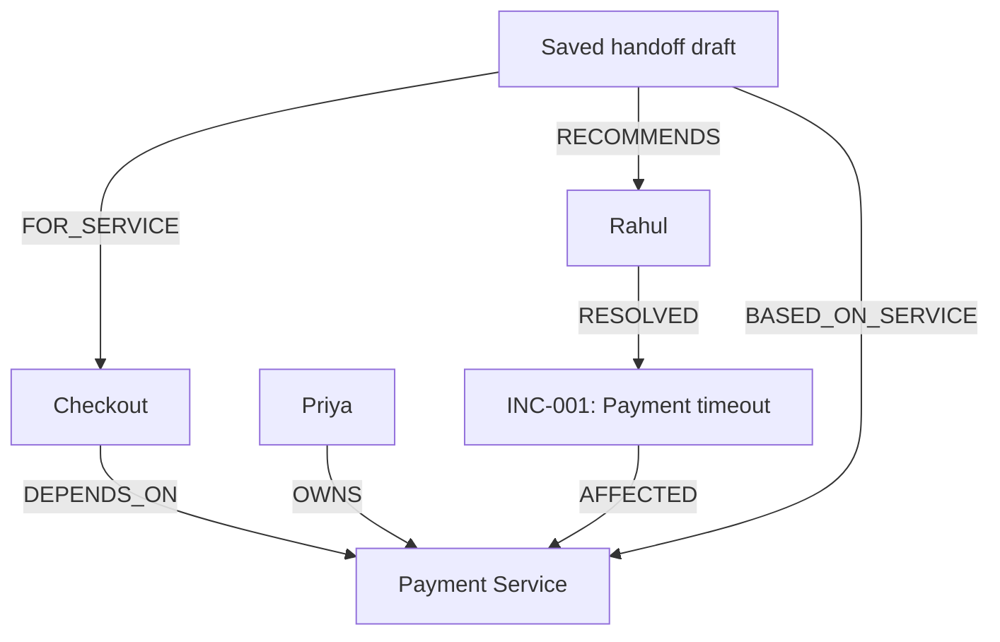

<!-- # TeamRescue

Find the right person to help with a service incident—and see the evidence.

TeamRescue is an AI incident-response assistant built with FalkorDB,
Google Gemini, React, and Express.

Built for Graph Hacks: Context for AI Agents.
Target track: Company Brain.

## The problem

When a service fails, teams need to know who owns it, whether that
person is available, and who has relevant experience if the owner
cannot help. Those answers depend on relationships across services,
people, and past incidents.

## What TeamRescue does

- Answers questions about recorded services using Gemini tool calling.
- Reads ownership, dependencies, availability, and resolved incidents
  from FalkorDB.
- Prefers available owners, then available people with relevant
  incident experience.
- Shows readable evidence cards and raw tool results.
- Updates employee availability in the graph.
- Saves handoff drafts with the recommendation, evidence, and timestamp.
- Provides a labelled direct graph fallback when the AI response
  is unavailable.

Saving a handoff does not notify anyone or assign work.

## Why a graph?

The demo connects these facts:

- Checkout depends on Payment Service.
- Priya owns Payment Service.
- Rahul resolved incident INC-001.
- INC-001 affected Payment Service.

When Priya is unavailable and Rahul is available, TeamRescue can follow
these connections to recommend Rahul. When Priya becomes available,
the owner-first recommendation changes to Priya.

FalkorDB shapes the recommendation and stores the handoff records.

## Stack

- Frontend: React and Vite
- Backend: Node.js and Express
- Context and storage: FalkorDB
- AI: Google Gemini through @google/genai
- Local database runtime: Docker

## Run locally

### 1. Clone the repository

```powershell
git clone https://github.com/aditya052003/teamrescue.git
cd teamrescue
```

Install Node.js and Docker Desktop first. Start Docker Desktop
with Linux containers enabled.

### 2. Start FalkorDB

For a new installation:

```powershell
docker run -d --name teamrescue-db -p 127.0.0.1:6379:6379 -p 127.0.0.1:3000:3000 -v teamrescue-data:/data -e "REDIS_ARGS=--appendonly yes" falkordb/falkordb:latest
```

If this container already exists:

```powershell
docker start teamrescue-db
```

The named volume stores database data between container restarts.
Keep the volume to retain saved records.

### 3. Add fictional demo data

Run this command once the database is ready:

```powershell
docker exec teamrescue-db redis-cli GRAPH.QUERY teamrescue "MERGE (p:Person {name:'Priya'}) SET p.available=false MERGE (r:Person {name:'Rahul'}) SET r.available=true MERGE (s:Service {name:'Payment Service'}) MERGE (c:Service {name:'Checkout'}) MERGE (i:Incident {id:'INC-001'}) SET i.title='Payment timeout', i.status='resolved' MERGE (p)-[:OWNS]->(s) MERGE (c)-[:DEPENDS_ON]->(s) MERGE (r)-[:RESOLVED]->(i) MERGE (i)-[:AFFECTED]->(s)"
```

Running this again resets Priya and Rahul to the availability values
above. It does not delete saved handoffs.

### 4. Start the backend

```powershell
cd backend
npm.cmd ci
```

Create `backend/.env`:

```dotenv
GEMINI_API_KEY=your_key_here
GEMINI_MODEL=your_available_tool_calling_model
```

Replace both placeholders with your own configuration.
Never commit your API key.

Without an API key, direct graph fallback is available, but
AI tool calling is not enabled.

Start the backend:

```powershell
npm.cmd run dev
```

Backend: http://localhost:5000

### 5. Start the frontend

Open another terminal from the repository folder:

```powershell
cd frontend
npm.cmd ci
npm.cmd run dev
```

Open http://localhost:5173.

Keep Docker, the backend, and the frontend running.

On systems where `npm` works directly, it can be used instead
of `npm.cmd`.

## Demo walkthrough

1. Set Priya to unavailable and Rahul to available.
2. Ask: "Checkout is failing. Who can help and why?"
3. Inspect the recommendation and graph evidence for Rahul.
4. Set Priya to available and ask the same question again.
5. Observe the owner-first recommendation for Priya.
6. Select Checkout in the handoff form and save a draft.
7. Refresh the page and confirm the saved draft remains.

Handoff saving rechecks the graph. Its recommendation may differ
from an earlier answer if availability has changed.

## Build the frontend

From the frontend folder:

```powershell
npm.cmd run build
```

Vite writes the output to `frontend/dist`.
Building the frontend does not deploy the backend or database.

## Current scope and limitations

- Uses a small fictional dataset.
- Checks the requested service and its direct dependencies.
- Dependencies indicate possible impact, not a proven root cause.
- AI wording may be imperfect; inspect the graph evidence.
- Gemini latency and availability depend on the provider.
- Fallback follows a predefined graph lookup and is labelled accordingly.
- Saved drafts are historical records, not live availability reports.
- The AI does not yet retrieve saved handoffs as conversational memory.
- No authentication, tenant isolation, or notification integrations.
- Configured for local use; public deployment needs additional work.

## Author

Aditya Raut
https://github.com/aditya052003 -->

<div align="center">

# TeamRescue

### The right person. The connected context. The evidence.

An AI incident-response assistant that uses **FalkorDB** to find available experts, explain recommendations, and preserve handoff drafts.


**Built for Graph Hacks: Context for AI Agents**  
Track: **Company Brain**

[The idea](#the-idea) · [How it works](#how-it-works) · [Run locally](#run-locally) · [Demo walkthrough](#demo-walkthrough)

</div>

---

## The idea

> **“Checkout is failing. Who can help—and why?”**

Answering this requires more than finding someone with “payments” in their job title.

You need to know which service Checkout depends on, who owns that service,
whether they are available, and who has resolved related incidents before.

**TeamRescue connects those facts in FalkorDB and makes the recommendation inspectable.**

## A small scenario. A connected answer.

| What the graph knows | Why it matters |
| :--- | :--- |
| Checkout depends on Payment Service | Identifies a related service to investigate |
| Priya owns Payment Service | Establishes the service owner |
| Priya is unavailable | An alternative may be needed |
| Rahul resolved INC-001, which affected Payment Service | Provides evidence of relevant past experience |
| Rahul is available | Makes him an available backup candidate |

**Result:** recommend Rahul with the supporting relationships.

**Change Priya to available:** the owner-first recommendation changes to Priya.

The recommendation depends on current graph data.

> A service dependency shows possible impact. It does **not** prove the root cause of a failure.

## What you can do

| Feature | What it delivers |
| :--- | :--- |
| **Ask TeamRescue** | Ask a question about a recorded service in plain language |
| **Inspect the evidence** | See dependencies, ownership, and past incidents in readable cards |
| **Change availability** | Update employee availability directly in FalkorDB |
| **Find an expert** | Get a predefined graph recommendation without waiting for AI |
| **Save a handoff** | Store a draft with the recommended person, evidence, note, and timestamp |
| **Return later** | Reload saved handoff records after refreshing the page |
| **Handle AI interruptions** | Receive a labelled direct graph result when the AI response is unavailable |

## How it works

1. The backend loads the service names from FalkorDB.
2. Gemini selects a service-context tool based on the question.
3. Predefined, parameterized Cypher queries retrieve connected facts.
4. The backend selects an available owner, or an experienced available backup.
5. Gemini explains the result, and the UI displays the underlying evidence.
6. When the user saves a handoff, the backend rechecks the graph and stores a draft.

### The graph behind the answer



*This example shows a draft recommending Rahul while Priya is unavailable.*

### Why FalkorDB?

The answer depends on relationships across people, services, and incidents.

FalkorDB supplies the connections used to select an expert. It also stores
availability changes and saved handoff drafts linked to people and services.

The AI uses a bounded tool loop. It does not generate arbitrary Cypher
or directly assign work.

## Technology

| Layer | Technology |
| :--- | :--- |
| Interface | React, Vite, CSS |
| API | Node.js, Express |
| Connected context | FalkorDB, Cypher |
| AI tool calling | Google Gemini, `@google/genai` |
| Local database runtime | Docker with a persistent volume |

## Run locally

### Prerequisites

- Node.js and npm compatible with the project's Vite version
- Docker Desktop running with Linux containers
- Git
- A Gemini API key and an available model supporting function calling for AI mode

The commands below use Windows PowerShell. `npm.cmd` avoids PowerShell
blocking the `npm.ps1` launcher.

### 1. Clone the project

```powershell
git clone https://github.com/aditya052003/teamrescue.git
cd teamrescue
```

### 2. Start FalkorDB

For a new installation:

```powershell
docker run -d --name teamrescue-db -p 127.0.0.1:6379:6379 -p 127.0.0.1:3000:3000 -v teamrescue-data:/data -e "REDIS_ARGS=--appendonly yes" falkordb/falkordb:latest
```

If the container already exists:

```powershell
docker start teamrescue-db
```

Keep the `teamrescue-data` volume to retain database records.

### 3. Seed the demo graph

Once FalkorDB is ready, run:

```powershell
docker exec teamrescue-db redis-cli GRAPH.QUERY teamrescue "MERGE (p:Person {name:'Priya'}) SET p.available=false MERGE (r:Person {name:'Rahul'}) SET r.available=true MERGE (s:Service {name:'Payment Service'}) MERGE (c:Service {name:'Checkout'}) MERGE (i:Incident {id:'INC-001'}) SET i.title='Payment timeout', i.status='resolved' MERGE (p)-[:OWNS]->(s) MERGE (c)-[:DEPENDS_ON]->(s) MERGE (r)-[:RESOLVED]->(i) MERGE (i)-[:AFFECTED]->(s)"
```

All demo people, services, and incidents are fictional.

Running this command again resets Priya and Rahul's availability to the
values above. It does not delete saved handoffs.

### 4. Configure and start the backend

```powershell
cd backend
npm.cmd ci
```

Create a `.env` file inside `backend`:

```dotenv
GEMINI_API_KEY=your_key_here
GEMINI_MODEL=your_available_tool_calling_model
```

Replace the placeholders with your own configuration.

**Keep your API key private. Do not commit `.env`.**

```powershell
npm.cmd run dev
```

Without an API key, the app can provide direct graph fallback results,
but AI tool calling is disabled.

### 5. Start the frontend

Open another terminal in the repository folder:

```powershell
cd frontend
npm.cmd ci
npm.cmd run dev
```

| Component | Local address |
| :--- | :--- |
| **TeamRescue app** | http://localhost:5173 |
| Backend API | http://localhost:5000 |
| FalkorDB Browser | http://localhost:3000 |

Keep Docker, the backend, and the frontend running.

## Demo walkthrough

### 01 — Find the backup

Set **Priya unavailable** and **Rahul available**.

Ask:

> Checkout is failing. Who can help and why?

Inspect Rahul's recommendation and the historical incident evidence.

### 02 — Change the context

Mark **Priya available** and ask the same question again.

Observe the recommendation change to the available service owner.

### 03 — Preserve the decision

Select **Checkout** in the handoff form, add an optional note, and save.

Refresh the page to retrieve the saved draft.

> Saving rechecks the graph. If availability has changed, the saved
> recommendation may differ from an earlier AI answer.

## Build

From the `frontend` folder:

```powershell
npm.cmd run build
```

The output is written to `frontend/dist`.

This builds the frontend assets; it does not deploy the backend or database.

## Design choices

- **Evidence is visible:** inspect both readable cards and raw tool results.
- **Availability matters:** only people recorded as available are selected.
- **Owner-first selection:** prefer an available owner before an experienced backup.
- **Fallback is explicit:** direct graph results are labelled when AI is unavailable.
- **History stays historical:** saved drafts preserve the reasoning at lookup time.
- **Actions are clear:** saving a draft does not notify anyone or assign work.

## Current scope

This is a local hackathon prototype with a small fictional dataset.

- Context lookup covers the requested service and its direct dependencies.
- AI wording can be imperfect; graph evidence remains available for inspection.
- AI latency and availability depend on the provider.
- Direct graph fallback uses a predefined lookup, not AI reasoning.
- Saved handoffs are persistent records; the AI does not yet retrieve them
  as conversational memory.
- Authentication, tenant isolation, and external notifications are not implemented.
- Public deployment requires additional configuration and access controls.

## Author

**Aditya Raut**

[GitHub](https://github.com/aditya052003) · [Project repository](https://github.com/aditya052003/teamrescue)

---

<div align="center">

**TeamRescue — connected context for explainable incident handoffs.**

</div>